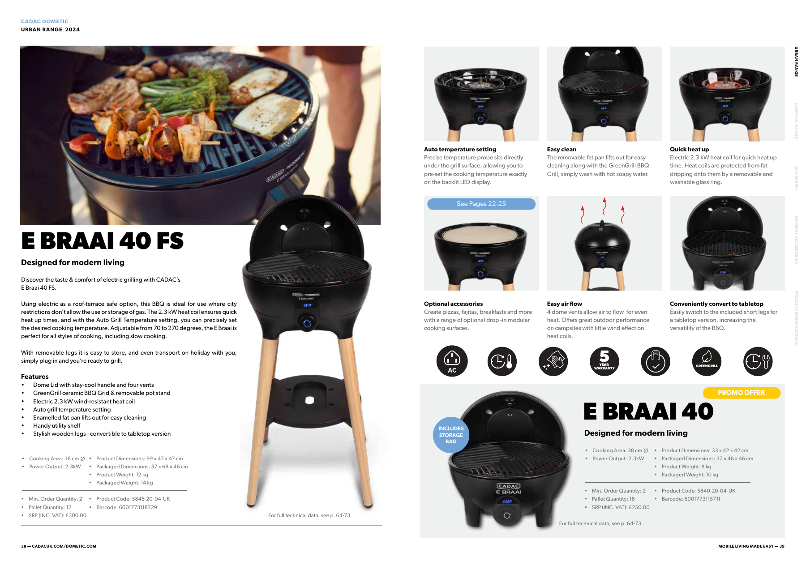
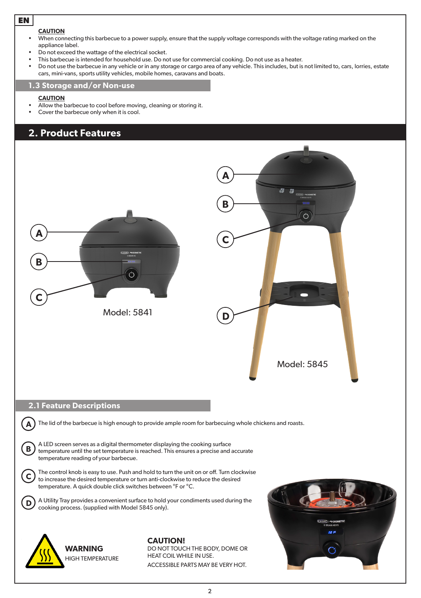

# CADAC E-Braai 40 FS 한글 사용 안내

루프탑에서 고기를 굽는 데 필요한 사용법 요약이다. 핵심 순서는 **기름 얇게 바르기 → 200°C에서 3~5분 예열 → 조리 → 전원 차단 → 식힌 뒤 세척**이다. 실제 대여품의 라벨과 현장 안내도 확인한다.

## 기본 사양

| 항목 | 사양 |
| --- | --- |
| 출력 | 2,300W |
| 조리면 | 원형 지름 약 38cm |
| 설정 온도 | 70~270°C |
| 크기와 무게 | 높이 99cm, 가로·세로 47cm, 12kg |
| 주요 부품 | 뚜껑, 코팅 그릴, 유리 링, 기름받이, 표시창, 다이얼 |

사양 출처: [CADAC UK 공식 카탈로그](https://www.cadacuk.com/wp-content/uploads/2024/01/Cadac-UK-2024-Trade-Catalogue-FINAL-LR.pdf), 인쇄 38~39쪽. 영국 판매 사양이며 전원 규격은 실제 제품 라벨을 따른다.

## 사용 전 확인

- 부품이 제자리에 있는지 확인하고 평평하고 열에 견디는 바닥에 둔다. 야외에서 사용한다.
- 불붙기 쉬운 물건과 뒤·옆으로 60cm 이상, 위로 1.2m 이상 간격을 둔다.
- 제품 정격에 맞는 접지 콘센트와 누전차단기 보호 전원을 사용한다. 설명서의 누전차단기 기준은 30mA 이하다.
- 연장선이 필요하면 설명서 조건인 야외용·접지·14AWG·최대 4m를 확인한다. 연결부는 건조하게 유지한다.
- 코드·플러그가 손상됐거나 제품에 이상이 있으면 사용하지 않는다. 아이가 뜨거운 본체에 접근하지 않도록 한다.

## 기름칠과 예열

1. 식은 불판에 **카놀라유나 해바라기유를 키친타월로 얇게** 펴 바른다. 불판의 볼록한 그릴 줄무늬까지 골고루 바른다. 붓은 필요 없다.
2. 다이얼을 길게 눌러 켠다.
3. **200°C에서 약 3~5분** 예열한 뒤 음식을 올린다. 기름 없이 가열하거나 빈 불판을 오래 과열하면 코팅이 손상될 수 있다.

설명서는 올리브유보다 카놀라유·해바라기유를 권장한다. 고기를 미리 기름에 재워두는 것과 불판 코팅용 기름칠은 별개다.

## 다이얼과 표시창

| 조작 | 기능 |
| --- | --- |
| 길게 누르기 | 전원 켜기·끄기 |
| 시계 방향으로 돌리기 | 설정 온도 올리기 |
| 반시계 방향으로 돌리기 | 설정 온도 내리기 |
| 빠르게 두 번 누르기 | °C와 °F 전환 |

온도를 설정하면 표시창이 세 번 깜박인다. 예열 중에는 온도 상승을 보여주고, 목표에 도달하면 설정값을 표시한다. **고기를 올린 뒤 표시창 숫자가 그대로여도 실제 불판 온도는 잠시 낮아질 수 있다.**

## 굽는 동안

- 실리콘·나무 도구를 사용한다. 금속 집게나 가위로 코팅을 긁지 않는다.
- 바람이 불거나 날씨가 쌀쌀하면 고기가 늦게 익을 수 있으니 뚜껑을 덮어 굽는다.
- 예열·조리 중에는 자리를 비우거나 그릴을 옮기지 않는다. 뜨거운 부품을 다룰 때는 내열 장갑을 쓴다.
- **기름에 불이 붙으면 뚜껑을 닫고 전원을 끈 뒤, 안전하게 플러그를 뺀다. 불이 꺼질 때까지 뚜껑을 닫아두며 물을 붓지 않는다.**

## 종료와 세척

1. 다이얼을 길게 눌러 끄고 플러그를 뺀다.
2. 충분히 식힌다. 뜨거운 불판을 찬물에 바로 담그지 않는다.
3. 분리형 불판·기름받이는 미지근한 세제물과 부드러운 스펀지로 닦아 기름기를 제거한다. 철수세미·연마제는 사용하지 않는다.
4. 전기 본체는 물기를 짠 천으로 닦는다. **본체를 물에 담그거나 내부에 물을 뿌리지 않는다.**
5. 물기를 말린 뒤 보관할 때는 키친타월로 식용유를 살짝 코팅해 둔다. 완전히 식고 마른 상태로 보관한다.

루프탑에 수도가 없으므로 식힌 분리 부품을 세척할 장소는 주인과 정한다.

## 오류가 표시될 때

| 표시 | 의미와 대처 |
| --- | --- |
| E1·E2 | 조리면 온도 센서 이상. 플러그를 뺐다가 재시작한다. |
| E3·E4 | 메인보드 온도 센서 이상. 플러그를 빼고 식힌 뒤 재시작한다. |

오류가 계속되면 사용을 중단하고 루프탑 주인에게 알린다. 임의로 분해하거나 수리하지 않는다.

## 이번 모임의 조리 순서

아래는 세준의 메뉴에 맞춘 운영 순서다.

- 첫 판에 **양고기·소고기와 가니시를 함께** 굽고, 이어 마약 옥수수를 만든다. 이후 남은 양·소고기를 추가하고 목살로 마무리한다.
- 8명분 고기 약 3.8kg을 여러 판에 나누어 굽는다. 고기가 서로 겹치지 않게 올리고, 다 익는 대로 새 접시에 옮겨 먹기 좋게 잘라 낸다.
- 버섯·파프리카는 첫 고기와 함께 빈자리에 조금씩 굽고, 옥수수는 첫 고기 다음에 뚜껑을 덮어가며 중간중간 굴려 굽는다.
- 고기 두께와 바람에 맞춰 온도를 조절한다. 270°C 최고 온도를 계속 유지할 필요는 없다.
- 고기는 굽기 전에 물기를 닦고 허브솔트로 가볍게 밑간한다. 불판용 식용유는 지인 집에 있는 것을 활용할 예정이며 실제 보유 여부는 미확인이다. 카놀라유·해바라기유를 권장한다.

## 공식 원본

사용법 출처: [CADAC 공식 설명서](https://www.cadacinternational.com/amfile/file/download/file/52/), 모델 5841·5845 공용, 영어 인쇄 1~5쪽(PDF 3~7쪽). E-Braai 40 FS는 모델 5845다. 이 안내는 사용에 필요한 부분을 요약했으며 보증약관·부품목록 등은 원본에서 확인할 수 있다.

- [공식 설명서 PDF](references/CADAC-E-Braai-40-FS-manual.pdf)
- [공식 카탈로그 PDF](references/CADAC-UK-2024-catalogue.pdf)
- [영문 예열 및 코팅 관리 페이지 이미지](assets/e-braai-40-operation.png)

2026년 10월 10일 정리. 사진은 공식 PDF 페이지를 그대로 렌더링했다.
